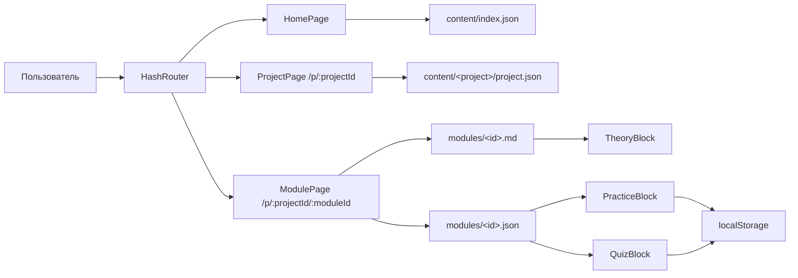

# DevOps Learning Platform

Персональная база знаний по моим DevOps-проектам. Каждый проект разбит на модули от простого к сложному, в каждом модуле три блока:

- **Теория** — выжимка без воды: команды, таблицы, разбор ошибок из реального проекта.
- **Практика** — задачи со скрытыми решениями (кнопка «Показать ответ»), подсказками и отметкой «решено».
- **Квиз** — вопросы с вариантами ответов, проверкой и пояснением.

Прогресс по задачам и лучший результат квиза сохраняются в `localStorage` браузера.

**Стек:** React 19 · Vite 8 · React Router 7 (HashRouter) · react-markdown + remark-gfm · CSS Modules · GitHub Pages

## Проекты

| # | Проект | Модулей | Задач | Вопросов | Репозиторий |
|---|---|---|---|---|---|
| 1 | SQL / PostgreSQL | 10 | 92 | 40 | [sql-postgresql-practice](https://github.com/aminalkobaili-bash/sql-postgresql-practice) |
| 2 | Linux Administration Basics | 9 | 48 | 36 | [linux-administration-basics](https://github.com/aminalkobaili-bash/linux-administration-basics) |
| 3 | Linux Networking | 7 | 38 | 28 | [linux-networking](https://github.com/aminalkobaili-bash/linux-networking) |
| 4 | Linux System Monitoring | 7 | 42 | 28 | [linux-system-monitoring](https://github.com/aminalkobaili-bash/linux-system-monitoring) |
| 5 | Flask Tic-Tac-Toe API | 7 | 41 | 28 | [flask-tictactoe-api](https://github.com/aminalkobaili-bash/flask-tictactoe-api) |
| 6 | Docker: nginx + FastCGI | 7 | 41 | 28 | [docker-nginx-fastcgi](https://github.com/aminalkobaili-bash/docker-nginx-fastcgi) |
| 7 | GitLab CI/CD Pipeline | 8 | 44 | 32 | [gitlab-cicd-pipeline](https://github.com/aminalkobaili-bash/gitlab-cicd-pipeline) |
| 8 | Docker Compose → Swarm | 8 | 46 | 32 | [docker-compose-microservices](https://github.com/aminalkobaili-bash/docker-compose-microservices) |
| | **Всего** | **63** | **392** | **252** | |

## Архитектура



Бэкенда нет: весь контент — JSON и Markdown в репозитории, Vite встраивает их в бандл через `import.meta.glob` (`src/content/content.js`).

```text
src/
├── main.jsx, App.jsx           # HashRouter и маршруты
├── components/
│   ├── Layout.jsx              # шапка, прокрутка наверх при смене страницы
│   ├── CodeBlock.jsx           # блок кода с кнопкой «Копировать»
│   └── blocks/                 # TheoryBlock, PracticeBlock, QuizBlock
├── hooks/useLocalStorage.js
├── pages/                      # HomePage, ProjectPage, ModulePage, NotFound
└── content/
    ├── index.json              # список проектов на главной
    └── <project>/
        ├── project.json        # описание, стек, список модулей
        └── modules/<id>.json + <id>.md
```

## Добавить модуль

1. Добавить модуль в `modules` файла `src/content/<project>/project.json`.
2. Создать `src/content/<project>/modules/<id>.md` — теория.
3. Создать `src/content/<project>/modules/<id>.json`:

```json
{
  "id": "01-example",
  "theoryFile": "01-example.md",
  "practice": [
    { "id": "ex00", "task": "…", "hint": "…", "solution": "…", "language": "bash", "note": "…" }
  ],
  "quiz": [
    { "id": "q1", "question": "…", "options": ["…", "…", "…", "…"], "correctIndex": 2, "explanation": "…" }
  ]
}
```

Модуль без `.json` показывается в списке, но неактивен. Код менять не нужно.

## Запуск

```bash
npm install
npm run dev        # http://127.0.0.1:5173
npm run build      # сборка в dist/
npm run lint
```

## Деплой

`.github/workflows/deploy.yml`: на каждый push в `main` — `npm ci` → lint → build → публикация `dist/` на GitHub Pages.

Один раз в настройках репозитория: **Settings → Pages → Source: GitHub Actions**.

- `HashRouter` (адреса вида `/#/p/sql/01-select`): GitHub Pages отдаёт статические файлы и ничего не знает о маршрутах SPA — с `BrowserRouter` прямая ссылка на модуль давала бы 404.
- `base: './'` в `vite.config.js`: относительные пути к ассетам, сайт работает в подпапке `https://<user>.github.io/<repo>/`.

## Как проверялся контент

Решения задач взяты из исходных репозиториев. Где было возможно, утверждения теории и ответы квизов проверены запуском: SQL — на временном PostgreSQL 16, Bash и Python — локально и в WSL Ubuntu 24.04, minimax — полным перебором партий. Задачи, которых не было в исходных проектах, помечены в пояснении к задаче.
